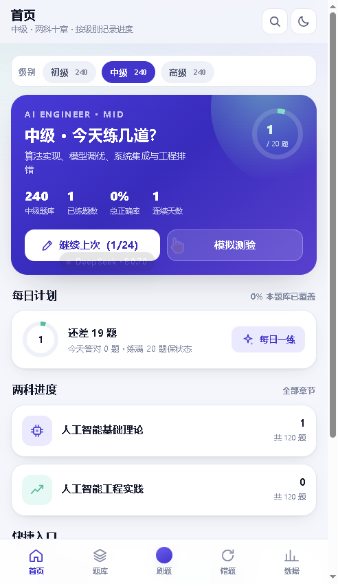
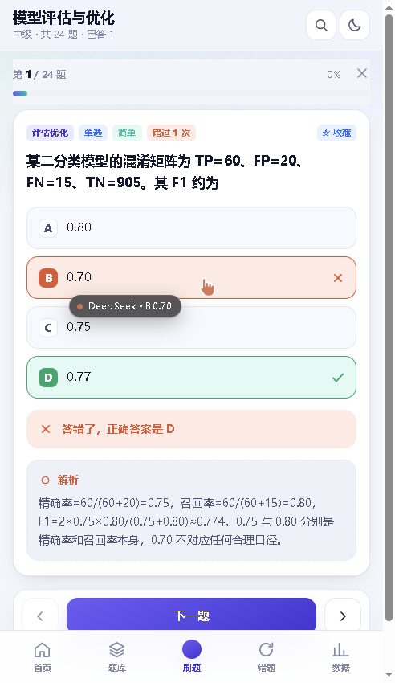

# AI工题库 · 人工智能工程技术人员（初 / 中 / 高）

给手机刷题用的单页应用（PWA）：**初级 / 中级 / 高级三套题库**，每个级别两科十章、240 道原创模拟题，合计 720 题；无后端、无广告、无登录，断网可用。

线上地址：https://al1c0ach.github.io/ai-engineer-exam/

手机扫码直达：


| 首页 | 答题 |
| --- | --- |
|  |  |

## 三个级别

| 级别 | 侧重 | 题量 |
| --- | --- | --- |
| 初级 | 基础概念、常见算法、常用工程做法 | 240（两科十章） |
| 中级 | 算法实现、模型调优、系统集成、工程排错 | 240（两科十章） |
| 高级 | 架构设计、平台体系、治理合规、技术决策 | 240（两科十章） |

首页、题库、统计页顶部的「级别」胶囊可随时切换；答题记录与统计按级别分别计算，错题本跨级别汇总并带级别标签。

## 功能

- **分类题库**：每个级别两科十章，每章 4~5 个考点，可看章节进度与考点分布
- **练习**：顺序 / 乱序 / 只做没做过 / 只做错题；单选点击即判，多选勾选后提交；答对答错都出解析
- **模拟测验**：从当前级别随机抽 50 题，答题时不显示对错，交卷统一判分、列错题、计时
- **错题本 / 收藏**：答错自动收录，答对自动移除；错题本跨级别汇总，可一键成组重练
- **学习统计**：累计答题、正确率、连续天数、章节正确率条形图、最近练习记录、薄弱章节建议
- **搜索**：按题干、选项、考点、解析全文检索（三级全库），结果带级别标识，可直接打开那道题
- **体验**：深浅色主题、题干字号三档、选项乱序、答对自动下一题、键盘快捷键（1-4 选择 / Enter 下一题 / F 收藏）、进度本地保存（localStorage）、PWA 离线

## 手机使用

1. 手机浏览器打开 https://al1c0ach.github.io/ai-engineer-exam/
2. iPhone：Safari → 分享 → 添加到主屏幕；Android：Chrome → ⋮ → 添加到主屏幕
3. 之后从桌面图标直接进入，断网也能继续刷，进度保存在本机

## 目录结构

```
index.html             页面骨架
assets/styles.css      样式（移动优先 + 桌面侧栏）
assets/app.js          应用逻辑（原生 JS，无依赖）
assets/questions.js    构建产物：window.__QB = {meta, questions}
assets/questions.json  同上，便于外部读取
assets/icons/          PWA 图标
data/level-*.json      题库源数据：level-<junior|mid|senior>-<basis|practice>.json
tools/build.js         合并 + 校验 + 生成 questions.js
tools/sample.js        随机抽样核对题目
tools/icon.html        图标 SVG 源，用来导出 PNG
manifest.json          PWA 清单
sw.js                  Service Worker（离线缓存）
```

## 改题库

题目源数据在 `data/`，文件名决定级别与科目：`level-junior-basis.json`（初级基础理论）、`level-mid-practice.json`（中级工程实践）等。每道题：

```json
{
  "id": "m-ml-001",
  "subject": "basis",
  "chapter": "ml",
  "topic": "模型调优与超参数",
  "type": "single",
  "stem": "题干",
  "options": ["A 选项文字", "B 选项文字", "C 选项文字", "D 选项文字"],
  "answer": [1],
  "explain": "解析",
  "difficulty": 2,
  "tags": ["高频"]
}
```

- `chapter` 填**章节 slug**（如 `ml`、`dl`、`sys`、`platform`），级别由文件名决定，构建时拼成 `mid-ml` 这种完整章节 id
- `type`：`single`（answer 1 个下标）/ `multi`（answer 2~3 个下标，题干前加「（多选）」，构建时自动去掉该前缀）
- `answer` 是 **0 基下标**；`topic` 必须在该章节 `tools/build.js` 的 META 里定义
- 改完执行：

```powershell
cd D:\WUxingString\ai-engineer-exam
node tools/build.js      # 校验并生成 assets/questions.js + questions.json
node tools/sample.js 10  # 随机抽 10 题人工核对
```

`build.js` 会检查：id 全局唯一（三级之间也不能撞）、答案下标合法、单选/多选答案数量、级别与章节考点归属、题干重复、解析长度；全部通过才写入产物，否则列出问题并以非 0 退出。

## 关于题目

题目依据《人工智能工程技术人员国家职业技术技能标准》与公开学习资料**原创编写**，用于考前自测与知识梳理。

- 初级 240 题：数学与 Python 基础、机器学习基础、深度学习、NLP 与语音、计算机视觉、数据与算力、训练部署、产品集成、大模型、伦理法规
- 中级 240 题：机器学习进阶、深度学习进阶、NLP 与视觉工程、特征工程、评估与优化、算法工程、训练推理优化、系统集成、大模型应用工程、安全合规
- 高级 240 题：算法架构与前沿、大模型系统、分布式训练、AI 治理、方案论证、平台架构、数据治理、产品架构、团队工程、战略创新
- **不是官方真题，也不代表正式考试的题量、时长与分值**；发现题目或解析有误，欢迎反馈修订

## 部署

纯静态站点，任意静态托管都能跑（GitHub Pages / Cloudflare Pages / Vercel / 对象存储）。

更新流程：

```powershell
git add -A; git commit -m "update"; git push
```

推送后 1~2 分钟内生效；手机端重新打开会拿到新版本（HTML 走网络优先，静态资源缓存优先并后台更新；改版时同步改 `sw.js` 里的 `CACHE` 版本号）。

## 浏览器支持

iOS Safari 15+、Android Chrome 90+、桌面 Chrome / Edge / Safari 最新版。使用 `color-mix`、`dvh`、`conic-gradient` 等现代特性，过旧浏览器外观会降级但不影响答题。
